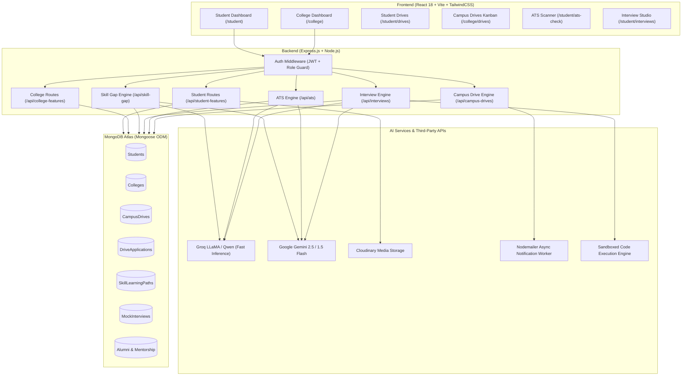
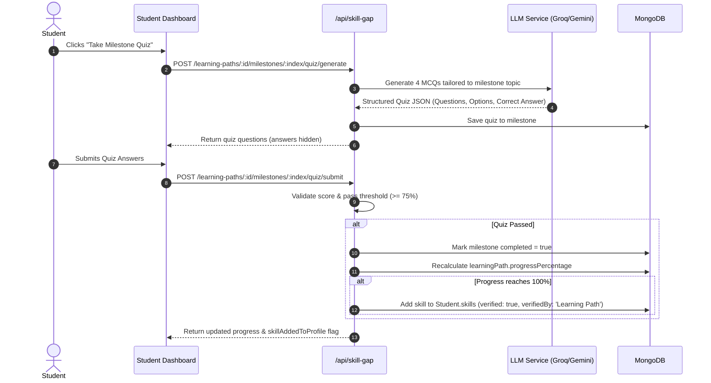
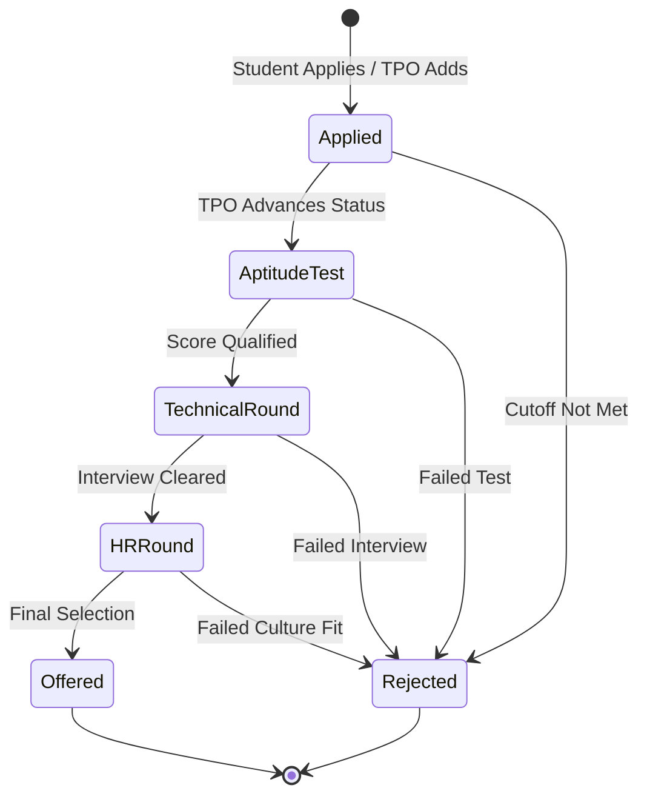
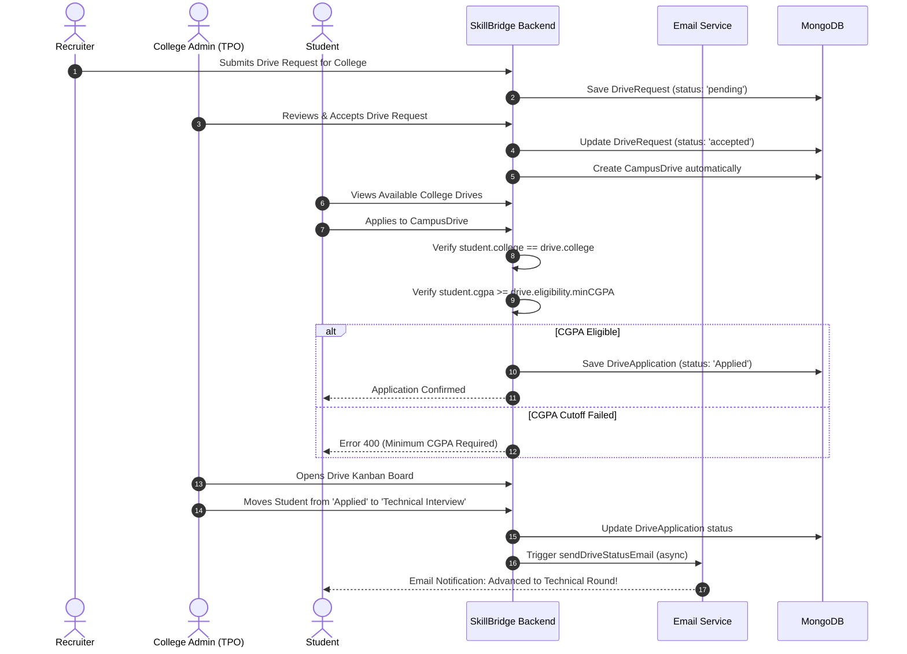

# SkillBridge: Student & College Features Comprehensive Documentation

> **Platform:** Skill Gap Analyser & Placement Intelligence Platform (SkillBridge)  
> **Target Audience:** Developers, Technical Leads, Training & Placement Officers (TPOs), and Students  
> **Last Updated:** October 2026  
> **Version:** 2.0 (Production Architecture)

---

## Table of Contents
1. [Platform Overview & Role-Based Architecture](#1-platform-overview--role-based-architecture)
2. [Student Features & Ecosystem (Deep Dive)](#2-student-features--ecosystem-deep-dive)
   - [2.1 Student Journey & Onboarding](#21-student-journey--onboarding)
   - [2.2 Profile Management & Completion Engine](#22-profile-management--completion-engine)
   - [2.3 Placement Readiness Score (PRS) Algorithm](#23-placement-readiness-score-prs-algorithm)
   - [2.4 AI Skill Gap Analysis Engine](#24-ai-skill-gap-analysis-engine)
   - [2.5 Dynamic Personalized Learning Paths & Skill Sync](#25-dynamic-personalized-learning-paths--skill-sync)
   - [2.6 AI Mock Interview Simulator & Code Sandbox](#26-ai-mock-interview-simulator--code-sandbox)
   - [2.7 AI-Powered ATS Resume Scanner](#27-ai-powered-ats-resume-scanner)
   - [2.8 Community Interview Experiences Portal](#28-community-interview-experiences-portal)
   - [2.9 Alumni Mentorship Network](#29-alumni-mentorship-network)
   - [2.10 Campus Placement Drives & Application Tracking](#210-campus-placement-drives--application-tracking)
3. [College & TPO Administration Features (Deep Dive)](#3-college--tpo-administration-features-deep-dive)
   - [3.1 Executive Placement Dashboard & KPI Analytics](#31-executive-placement-dashboard--kpi-analytics)
   - [3.2 Student Cohort Directory & Advanced Filters](#32-student-cohort-directory--advanced-filters)
   - [3.3 Institutional Skill Analytics & Heatmaps](#33-institutional-skill-analytics--heatmaps)
   - [3.4 Market Curriculum Gap Analysis](#34-market-curriculum-gap-analysis)
   - [3.5 At-Risk Student Radar (Early Warning System)](#35-at-risk-student-radar-early-warning-system)
   - [3.6 Automated Smart Shortlisting](#36-automated-smart-shortlisting)
   - [3.7 Campus Drive Operations & Application Kanban Board](#37-campus-drive-operations--application-kanban-board)
   - [3.8 Recruiter CRM & Engagement Tracking](#38-recruiter-crm--engagement-tracking)
   - [3.9 Alumni Mentorship Administration](#39-alumni-mentorship-administration)
   - [3.10 Institutional Profile & Accreditation Settings](#310-institutional-profile--accreditation-settings)
4. [Complete REST API Specification](#4-complete-rest-api-specification)
   - [4.1 Student Endpoints](#41-student-endpoints)
   - [4.2 College Administration Endpoints](#42-college-administration-endpoints)
   - [4.3 Skill Gap, ATS & Interview Shared Endpoints](#43-skill-gap-ats--interview-shared-endpoints)
5. [Database Schema Reference](#5-database-schema-reference)
6. [Interactive Sequence Workflows](#6-interactive-sequence-workflows)

---

## 1. Platform Overview & Role-Based Architecture

SkillBridge is an end-to-end intelligent placement and skill development ecosystem. The platform bridges the divide between corporate hiring expectations, institutional curriculum, and student career readiness through AI analytics, automated workflows, and real-time tracking.

### System Architecture Diagram



---

## 2. Student Features & Ecosystem (Deep Dive)

### 2.1 Student Journey & Onboarding
The student experience is engineered as a progressive career journey:
1. **Registration & Role Verification**: Students sign up with university email, selecting their graduation year, department, and university roll number.
2. **Profile Enrichment**: Students complete their academic records, enter technical/soft skills with self-rated proficiency, and upload their resume and profile photo.
3. **Skill Gap Diagnostics**: AI analyzes the student's profile against industry standards for their chosen target role (e.g., *Full Stack Developer*, *DevOps Engineer*, *Data Scientist*).
4. **Actionable Upskilling**: Interactive weekly learning roadmaps with curated resources and knowledge-check quizzes.
5. **Interview Readiness**: Voice and vision-enabled mock interviews with real-time browser coding sandboxes and ATS resume optimization.
6. **Placement Execution**: Browsing on-campus drives, validating CGPA requirements, one-click applying, and tracking progress across assessment rounds.

---

### 2.2 Profile Management & Completion Engine
The student profile serves as the single source of truth for campus placement eligibility and AI personalization.

#### Automated Profile Completion Weighting
Profile completion percentage is calculated automatically in the Mongoose `pre("save")` hook of `Student.js`:
- **Required Fields (70% total weight):**
  - `firstName`, `lastName`, `email`, `phone`, `rollNumber`, `department`, `degree`, `graduationYear`, `cgpa`, `resumeUrl`
- **Optional Fields (30% total weight):**
  - `dateOfBirth`, `gender`, `profilePicture`, `linkedinUrl`, `githubUrl`, `portfolioUrl`, `education10th`, `education12th`, `city`, `state`

$$\text{Profile Completion \%} = \left(\frac{\text{Completed Required Fields}}{10} \times 70\right) + \left(\frac{\text{Completed Optional Fields}}{10} \times 30\right)$$

#### Cloudinary Media Integration
- **Resume Upload (`POST /api/student-features/upload-resume`)**: Accepts PDF files (up to 10MB), uploads to Cloudinary folder `resumes/`, extracts secure HTTPS URL, and sets `student.resumeUrl`.
- **In-Browser Resume Viewer (`GET /api/student-features/resume-view`)**: Redirects to the CDN URL for fast, zero-latency viewing inside embedded iframe viewers.
- **Profile Picture Upload (`POST /api/student-features/upload-profile-picture`)**: Accepts JPG/PNG images, crops/stores in Cloudinary, and updates profile completion.

---

### 2.3 Placement Readiness Score (PRS) Algorithm
The Placement Readiness Score is a composite metric (0 to 100) visible on the student's dashboard hero banner, providing immediate feedback on how market-ready they are for upcoming recruitment drives.

When an active Skill Gap Analysis exists:
$$\text{PRS} = \text{round}\Big(0.40 \times \text{Skill Gap Readiness Score} + 0.40 \times \text{Profile Completion \%} + 0.20 \times \text{Resume Presence Score}\Big)$$

Where:
- **Skill Gap Readiness Score**: Calculated by AI evaluating student's verified skills against benchmark domain requirements.
- **Profile Completion \%**: Calculated from the 70/30 required/optional formula above.
- **Resume Presence Score**: 100 if `resumeUrl` exists; 0 otherwise.

*Fallback without Skill Gap Analysis:* $\text{PRS} = \text{round}(0.70 \times \text{Profile Completion \%} + 0.30 \times \text{Resume Presence Score})$.

---

### 2.4 AI Skill Gap Analysis Engine
The Skill Gap engine compares student competencies with live job market requirements.

- **Trigger Endpoint:** `POST /api/skill-gap/analyze`
- **Cooldown Protection:** Enforces a **5-minute cooldown** per student to prevent redundant LLM invocations and manage API rate limits. Returns HTTP 429 with remaining minutes if called too soon.
- **Evaluation Pipeline:**
  1. Retrieves student skills, projects, and department from database.
  2. Queries `DomainSkillRequirement` for the target domain and role.
  3. LLM compares student competencies against required skills, categorized into:
     - **Acquired Skills**: Skills already present with matched proficiency.
     - **Missing Skills / Critical Gaps**: Critical industry requirements absent from student's profile.
     - **Recommended Proficiency Targets**: Target levels (e.g., intermediate $\to$ advanced).
  4. Generates an `overallReadinessScore` (0–100) and stores in `SkillGapAnalysis` collection.
  5. Automatically synthesizes tailored `SkillLearningPath` records for each missing skill.

---

### 2.5 Dynamic Personalized Learning Paths & Skill Sync
For every identified skill gap, the system provisions an adaptive learning path.



#### Key Capabilities:
- **Automatic Milestone Progress:** Progress updates proportionally as milestones are cleared.
- **AI-Powered Milestone Quizzes:** Dynamically generated 4-option multiple-choice quizzes targeting the specific week's syllabus.
- **Skill Profile Synchronization:** When a learning path reaches **100% completion**, the system automatically injects the skill into `student.skills` marked with `verified: true` and `verifiedBy: "Skill Gap Analyser (Learning Path)"`, raising their placement readiness score.
- **Smart Date Rescheduling (`POST /learning-paths/:id/reschedule`):** Shifts due dates forward weekly from today for all uncompleted milestones if a student falls behind schedule.
- **Curated Resource Refresh (`POST /learning-paths/:id/refresh-resources`):** Re-prompts the AI to backfill vetted video tutorials, documentation links, and project repositories into milestone resources.

---

### 2.6 AI Mock Interview Simulator & Code Sandbox
A comprehensive interview preparation platform combining algorithmic problem-solving with behavioral and non-verbal communication tracking.

#### Modes & Configurations:
- **Profile Mode:** Generates questions based on student's resume, projects, and target role.
- **Topic Drill Mode:** Deep-dives into a specific topic (e.g., *Dynamic Programming*, *System Design*, *Kubernetes Networking*).
- **Round Types:** Technical Screen, Live Coding, or Behavioral / Leadership Principles.
- **Difficulty:** Easy, Medium, Hard.
- **Company Styles:** Curated question templates replicating Google, Microsoft, Amazon, Atlassian, or General MNC standards.

#### Multi-Modal 4-Axis Scoring System:
Each completed interview session is evaluated across four distinct dimensions:
1. **Technical & Code Accuracy (0–100):** Correctness of algorithm, edge case handling, and time/space complexity analysis.
2. **Voice Communication (0–100):** Articulation clarity, confidence, and structured problem clarification before coding.
3. **Posture & Framing (0–100):** Real-time computer vision analysis tracking user alignment and engagement.
4. **Eye Contact & Gaze Alignment (0–100):** Vision tracking measuring direct camera engagement vs. distraction.

#### Integrated Code Execution Sandbox:
- Endpoint: `POST /api/interviews/compile`
- Supports live compilation and test case execution for JavaScript, Python, C++, and Java.
- Evaluates student solutions against hidden inputs and returns stdout, stderr, execution time, and pass/fail status.

---

### 2.7 AI-Powered ATS Resume Scanner
Students can test their resume against real-world job descriptions before applying.

- **Route:** `POST /api/ats/analyze`
- **Fallback Architecture:**
  1. Primary: **Groq** high-speed LLM inference (`gpt-oss-120b` / `qwen3.8-27b`).
  2. Secondary: **Google Gemini** (`gemini-2.5-flash` / `gemini-1.5-flash`).
  3. Tertiary: Built-in **Offline Heuristic Keyword Scanner** with regex word boundary matching for over 70+ technology stacks to ensure zero downtime.
- **Output:**
  - `matchScore` (0–100%)
  - `matchedKeywords` (e.g., React, Node.js, MongoDB)
  - `missingKeywords` (e.g., Docker, Kubernetes, CI/CD)
  - `actionableAdvice` (tailored recommendations on phrasing projects and certifications to beat ATS screening algorithms).

---

### 2.8 Community Interview Experiences Portal
A peer-to-peer knowledge sharing hub where students read and contribute verified on-campus and off-campus interview experiences.

- **Read Experiences (`GET /api/interviews/experiences`):** Filter by company, difficulty (Easy/Medium/Hard), outcome (Selected/Rejected), or full-text search. Includes pre-seeded experiences from Google, Atlassian, Microsoft, and Amazon.
- **Publish Experience (`POST /api/interviews/experiences`):** Students share details including round-by-round interview questions, assessment format, compensation package offered (LPA), and preparation tips.
- **Upvote Mechanism (`POST /api/interviews/experiences/:id/upvote`):** Community upvotes highlight the most helpful experiences.

---

### 2.9 Alumni Mentorship Network
Connects current students with placed alumni for 1-on-1 mentorship.

- **Alumni Directory (`GET /api/student-features/alumni`):** Browse alumni mentors filterable by company (e.g., Amazon, Oracle, TCS), tech skill, and batch.
- **Booking Requests (`POST /api/student-features/alumni/:id/request`):** Book mentorship sessions across 4 categories:
  - *Mock Interview*
  - *Domain Guidance*
  - *Resume Review*
  - *Career Referral*
- **Request Tracking (`GET /api/student-features/mentorship/my-requests`):** Track booking status (`pending`, `accepted`, `rejected`, `completed`) with alumni contact info and meeting links.

---

### 2.10 Campus Placement Drives & Application Tracking
- **Available Drives (`GET /api/student-features/drives`):** Displays drives active or upcoming specifically for the student's college.
- **Automated Eligibility Enforcement:** When a student applies (`POST /api/student-features/drives/:id/apply`):
  - Validates that the drive belongs to the student's college.
  - Automatically verifies student's CGPA against `drive.eligibility.minCGPA`. Rejects application with clear error if CGPA is below cutoff.
  - Prevents duplicate applications.
- **Application History (`GET /api/student-features/drives/applications`):** Real-time status tracker (e.g., *Applied*, *Online Assessment*, *Interview*, *Offered*, *Rejected*).

---

## 3. College & TPO Administration Features (Deep Dive)

The College Administration portal equips Training & Placement Officers (TPOs) and department heads with institutional placement intelligence, cohort tracking, and recruiter management tools.

### 3.1 Executive Placement Dashboard & KPI Analytics
- **Route:** `GET /api/college-features/dashboard`
- **Key Performance Indicators (KPIs):**
  - **Total Students:** Total cohort size across all eligible batches.
  - **Placed Students:** Total number of students with confirmed offers.
  - **Placement Rate (\%):** Real-time calculated placement percentage:
    $$\text{Placement Rate} = \left(\frac{\text{Placed Students}}{\text{Total Students}}\right) \times 100$$
  - **Average Package (CTC):** Mean compensation package across all placed students (in ₹ LPA).
  - **Department Count:** Number of active academic departments tracked.
- **Departmental Drilldown:**
  - Standardizes raw department strings using `normalizeDepartment` helper (e.g., "Computer Science", "CSE", "Comp Sci" $\to$ "Computer Science & Engineering").
  - Computes per-department placement rates and student rosters.

---

### 3.2 Student Cohort Directory & Advanced Filters
- **Route:** `GET /api/college-features/students`
- **Capabilities:**
  - **Pagination:** Configurable page size and page offset.
  - **Filtering:** Filter by academic department, graduation year, and placement status (`unplaced`, `eligible`, `applying`, `placed`).
  - **Multi-Field Search:** Searches across student first name, last name, university roll number, internal college roll number, and email.
  - **Sorting:** Sort by CGPA, graduation year, or name in ascending/descending order.
  - **CSV Data Export (`GET /api/college-features/students/export?format=csv`):** Generates RFC 4180-compliant CSV of student data for institutional reporting and NAAC/NIRF accreditation.
  - **Manual Placement Record Updates (`PATCH /api/college-features/students/:id/placement`):** TPO can update placement status, CTC package, hiring company, job role, offer type (Regular/Dream/Super-Dream), and offer date.

---

### 3.3 Institutional Skill Analytics & Heatmaps
- **Route:** `GET /api/college-features/skills/analytics`
- **Institutional Insights:**
  - **Top 20 Campus Skills:** Aggregate count of student competencies across the entire institution.
  - **Proficiency Level Breakdown:** Distribution of each skill across *Beginner*, *Intermediate*, *Advanced*, and *Expert*.
  - **Category Coverage:** Percentage distribution across Domain Knowledge, Programming, Frameworks, and Tools.
- **Department-Specific Skill Audit (`GET /api/college-features/skills/department/:department`):** Inspects exact skill penetration within a specific department (e.g., Mechanical Engineering vs. Computer Science).

---

### 3.4 Market Curriculum Gap Analysis
- **Route:** `GET /api/college-features/curriculum-gap`
- **Mechanism:**
  1. Aggregates skill requirements across all active recruiter job postings (`Job` collection) to determine **Market Demand**.
  2. Aggregates all skills present across currently enrolled students to determine **Student Supply**.
  3. Calculates the delta: $\text{Gap} = \text{Demand Count} - \text{Supply Count}$.
  4. Flags **Critical Gaps**: Skills where market demand is high and current student supply is **less than 50% of demand**. Enables TPOs and Academic Deans to schedule targeted workshops and certification bootcamps.

---

### 3.5 At-Risk Student Radar (Early Warning System)
- **Route:** `GET /api/college-features/at-risk`
- **Objective:** Proactively detect unplaced students who are at high risk of remaining unplaced before graduation.
- **Risk Detection Rules:**
  - **Low CGPA:** $\text{CGPA} < 7.0$
  - **Low Skill Count:** Less than 3 verified technical skills on profile.
  - **High Rejection Rate:** More than 10 drive/job rejections without an offer.
- **Severity Classification:**
  - **Critical Risk:** $\ge 2$ risk factors triggered.
  - **Moderate Risk:** 1 risk factor triggered.
  - **Intervention:** Enables TPO to assign targeted alumni mentorship and remedial learning paths.

---

### 3.6 Automated Smart Shortlisting
- **Route:** `POST /api/college-features/shortlist`
- Allows TPOs to instantly query student cohorts against recruiter job eligibility criteria:
  - Minimum CGPA cutoff.
  - Mandatory skill checklist (matches all required skills).
  - Department criteria.
  - Exclude already-placed candidates (prevents placement hoarding).
- Returns student candidate count and complete profile objects.

---

### 3.7 Campus Drive Operations & Application Kanban Board
Manages full-lifecycle on-campus recruitment events.



#### Drive Operations:
- **Create Campus Drive (`POST /api/campus-drives`):** Set title, company, description, date, eligibility cutoffs (min CGPA, eligible departments, required skills), and custom round stages.
- **Drive Applications Kanban View (`GET /api/campus-drives/:id/applications`):** Returns applications grouped by current stage (`Applied`, `Aptitude Test`, `Technical Interview`, `HR Round`, `Offered`, `Rejected`).
- **Drag-and-Drop Status Advancement (`PUT /api/campus-drives/:id/applications/:appId/status`):** Updates candidate stage.
- **Automated Asynchronous Email Notifications:** On stage update, backend worker triggers `sendDriveStatusEmail`, alerting the student to their round advancement or offer letter.
- **Bulk Drive Shortlisting (`POST /api/college-features/shortlist-drive`):** Batch shortlists dozens of pre-screened students directly into Round 1 of a campus drive in a single click.

---

### 3.8 Recruiter CRM & Engagement Tracking
- **Route:** `GET /api/college-features/recruiter-crm`
- Tracks institutional relationships with corporate hiring partners:
  - **Total Drives Visited:** Historic count of recruitment drives held on campus.
  - **Total Hires Made:** Aggregate hires made by each employer.
  - **Last Campus Visit Date:** Timestamp of last engagement.
  - **Engagement Status:** Classified as **Active** (drives $\ge 1$) or **Dormant**.
- **Incoming Drive Requests (`GET /api/college-features/drive-requests`):** Recruiters can request on-campus recruitment drives.
- **Accept Drive Request (`PUT /api/college-features/drive-requests/:id/accept`):** Automatically provisions a formal `CampusDrive` linked to the recruiter's job posting.

---

### 3.9 Alumni Mentorship Administration
- **List Mentors (`GET /api/college-features/alumni`):** View all registered alumni across graduation years.
- **Add Mentor (`POST /api/college-features/alumni`):** TPO can add distinguished alumni with their current company, role, batch, LinkedIn profile, verified skills, and mentor availability flag.

---

### 3.10 Institutional Profile & Accreditation Settings
- **Retrieve Profile (`GET /api/college-features/profile`):** View college branding, accreditation tier, location, logo, and contact info.
- **Update Profile (`PUT /api/college-features/profile`):** Update college logo URL, contact emails, official website, and campus description.

---

## 4. Complete REST API Specification

### 4.1 Student Endpoints (`/api/student-features`)

| Method | Endpoint | Auth | Description | Request Body / Parameters |
|:---|:---|:---:|:---|:---|
| `GET` | `/me` | Student | Fetch student profile with calculated Placement Readiness Score | None |
| `PUT` | `/update-profile` | Student | Update personal, academic, skills, social links, preferences | JSON with profile fields |
| `POST` | `/upload-resume` | Student | Upload resume PDF to Cloudinary and update completion | `multipart/form-data` (`resume`: PDF) |
| `GET` | `/resume-view` | Student | Redirect to Cloudinary CDN URL for PDF viewing | None |
| `POST` | `/upload-profile-picture` | Student | Upload profile image to Cloudinary | `multipart/form-data` (`profilePicture`: Image) |
| `GET` | `/skill-gap` | Student | Fast overview of acquired vs missing skills for target role | None |
| `GET` | `/alumni` | Student | Search and filter alumni mentors | Query: `company`, `skill`, `search` |
| `POST` | `/alumni/:id/request` | Student | Request 1-on-1 mentorship session | JSON: `{ requestType, topic, message, preferredDate }` |
| `GET` | `/mentorship/my-requests` | Student | Get history of student's mentorship bookings | None |
| `GET` | `/interviews` | Student | Fetch community interview experiences | Query: `company` |
| `GET` | `/drives` | Student | List active/upcoming drives for student's college | None |
| `GET` | `/drives/applications` | Student | List all campus drive applications of student | None |
| `POST` | `/drives/:id/apply` | Student | Apply to campus drive (checks college & CGPA cutoff) | None (Drive ID in path) |

---

### 4.2 College Administration Endpoints (`/api/college-features`)

| Method | Endpoint | Auth | Description | Request Body / Parameters |
|:---|:---|:---:|:---|:---|
| `GET` | `/dashboard` | College Admin | KPI stats: totals, placed, placement rate, avg package, depts | None |
| `GET` | `/students` | College Admin | Paginated, searchable, filterable student directory | Query: `page`, `limit`, `department`, `graduationYear`, `placementStatus`, `search`, `sortBy`, `order` |
| `GET` | `/students/export` | College Admin | Export college student cohort to CSV format | Query: `format=csv` |
| `PATCH` | `/students/:id/placement` | College Admin | Mark placed or update CTC, company, role, offer type | JSON: `{ placementStatus, isPlaced, placedCompany, placementPackage, jobRole, offerType, offerDate }` |
| `GET` | `/skills/analytics` | College Admin | Top 20 skills, proficiency levels, category breakdown | None |
| `GET` | `/skills/department/:dept` | College Admin | Department-specific skill penetration & student lists | Param: `:dept` |
| `GET` | `/curriculum-gap` | College Admin | Compare market job demand vs student skills supply | None |
| `GET` | `/at-risk` | College Admin | Identify at-risk students (low CGPA, low skills, high rejections) | None |
| `POST` | `/shortlist` | College Admin | Automated shortlisting matching CGPA, skills, dept | JSON: `{ minCGPA, requiredSkills, department, excludePlaced }` |
| `POST` | `/shortlist-drive` | College Admin | Bulk shortlist array of students into drive round 1 | JSON: `{ driveId, studentIds, round }` |
| `GET` | `/recruiter-crm` | College Admin | Corporate recruiter engagement stats (visits, hires, status) | None |
| `GET` | `/drive-requests` | College Admin | View incoming campus recruitment requests from recruiters | None |
| `PUT` | `/drive-requests/:id/accept` | College Admin | Accept drive request and auto-create CampusDrive | Param: `:id` |
| `GET` | `/alumni` | College Admin | View alumni mentors registry | None |
| `POST` | `/alumni` | College Admin | Register new alumni mentor | JSON: `{ name, company, role, batch, department, email, linkedInProfile, skills, isMentor }` |
| `GET` | `/profile` | College Admin | Get college institutional profile details | None |
| `PUT` | `/profile` | College Admin | Update college name, location, website, logoUrl, contact | JSON: `{ name, location, logoUrl, contactEmail, contactPhone, website, about }` |

---

### 4.3 Skill Gap, ATS & Interview Shared Endpoints

| Method | Endpoint | Auth | Description | Request Body / Parameters |
|:---|:---|:---:|:---|:---|
| `POST` | `/api/skill-gap/analyze` | Student | Run AI Skill Gap Analysis (5-min cooldown) | JSON: `{ targetDomain, targetRole }` |
| `GET` | `/api/skill-gap/latest` | Student | Get latest active skill gap analysis & learning paths | None |
| `GET` | `/api/skill-gap/history` | Student | Historical log of past analyses | None |
| `GET` | `/api/skill-gap/domains` | Public/All | Get all available domains and career roles | None |
| `GET` | `/api/skill-gap/learning-paths` | Student | Fetch student's learning paths grouped by status | None |
| `PATCH` | `/api/skill-gap/learning-paths/:id/progress` | Student | Update milestone progress / auto-sync skill on 100% | JSON: `{ progress, milestoneIndex, completed }` |
| `POST` | `/api/skill-gap/learning-paths/:id/reschedule` | Student | Shift overdue milestone target dates forward | None |
| `POST` | `/api/skill-gap/learning-paths/:id/refresh-resources` | Student | AI-refresh curated milestone tutorials & links | None |
| `POST` | `/api/skill-gap/learning-paths/:id/milestones/:index/quiz/generate` | Student | AI-generate 4 MCQs for milestone topic | None |
| `POST` | `/api/skill-gap/learning-paths/:id/milestones/:index/quiz/submit` | Student | Submit quiz answers & auto-pass milestone | JSON: `{ score, passed }` |
| `POST` | `/api/ats/analyze` | Student | Multi-LLM ATS resume scan against Job Description | JSON: `{ jobDescription }` |
| `POST` | `/api/interviews/generate` | Student | Generate AI Mock Interview (Profile / Drill) | JSON: `{ targetRole, mode, domain, targetTopic, roundType, companyStyle, difficulty, questionCount }` |
| `POST` | `/api/interviews/:id/evaluate` | Student | Evaluate answers & 4-axis multi-modal metrics | JSON: `{ answers: [...], visionMetrics: { postureAlignment, eyeContactGaze } }` |
| `POST` | `/api/interviews/compile` | Student | Execute sandboxed code compilation | JSON: `{ language, code, input }` |
| `GET` | `/api/interviews/history` | Student | Fetch past mock interview attempts and scores | None |
| `GET` | `/api/interviews/experiences` | Student | Community interview experiences with filters | Query: `company`, `difficulty`, `outcome`, `search` |
| `POST` | `/api/interviews/experiences` | Student | Share real-world interview experience | JSON: `{ company, role, packageOffered, difficulty, rounds, tips, outcome }` |
| `POST` | `/api/interviews/experiences/:id/upvote` | Student | Upvote an interview experience | Param: `:id` |
| `GET` | `/api/campus-drives` | College Admin | List all drives for college | None |
| `POST` | `/api/campus-drives` | College Admin | Create new campus drive | JSON: `{ company, title, description, date, eligibility, rounds }` |
| `GET` | `/api/campus-drives/:id/applications` | College Admin | Kanban grouped applications for drive | Param: `:id` |
| `PUT` | `/api/campus-drives/:id/applications/:appId/status` | College Admin | Update application status & dispatch async email | JSON: `{ status }` |

---

## 5. Database Schema Reference

### Student Schema (`models/Student.js`)
```javascript
{
  user: { type: ObjectId, ref: "User", required: true, unique: true },
  college: { type: ObjectId, ref: "College" },
  firstName: String,
  lastName: String,
  email: String,
  phone: String,
  dateOfBirth: Date,
  gender: { type: String, enum: ["male", "female", "other", "prefer_not_to_say"] },
  profilePicture: String,
  
  // Academic
  rollNumber: { type: String, required: true },
  collegeRollNumber: { type: String, default: "" },
  department: { type: String, required: true },
  degree: String,
  specialization: String,
  admissionYear: Number,
  graduationYear: Number,
  currentSemester: Number,
  cgpa: Number,
  activeBacklogs: { type: Number, default: 0 },
  clearedBacklogs: { type: Number, default: 0 },

  // Skills & Links
  skills: [{
    skillName: String,
    proficiencyLevel: { type: String, enum: ["beginner", "intermediate", "advanced", "expert"] },
    verified: { type: Boolean, default: false },
    verifiedBy: String
  }],
  resumeUrl: String,
  linkedinUrl: String,
  githubUrl: String,
  portfolioUrl: String,

  // Career Preferences
  targetRole: String,
  dreamCompanies: [String],
  preferredLocations: [String],
  willingToRelocate: { type: Boolean, default: true },
  expectedSalaryMin: Number,
  expectedSalaryMax: Number,

  // Placement Records
  placementStatus: {
    type: String,
    enum: ["eligible", "applying", "placed", "opted_out", "unplaced"],
    default: "eligible"
  },
  isPlaced: { type: Boolean, default: false },
  placementPackage: Number, // in LPA
  placedCompany: String,
  jobRole: String,
  offerType: { type: String, default: "Regular" },
  offerDate: Date,
  
  // Auto-calculated
  profileCompletionPercentage: { type: Number, default: 0 }
}
```

### College Schema (`models/College.js`)
```javascript
{
  name: { type: String, required: true, unique: true },
  emailDomain: { type: String, unique: true, sparse: true },
  location: String,
  tier: { type: String, enum: ["tier1", "tier2", "tier3"], default: "tier2" },
  logoUrl: String,
  website: String,
  contactEmail: String,
  contactPhone: String,
  about: String,
  totalStudents: { type: Number, default: 0 },
  placedStudents: { type: Number, default: 0 },
  isVerified: { type: Boolean, default: false },
  subscriptionPlan: {
    type: String,
    enum: ["free", "basic", "premium", "enterprise"],
    default: "free"
  }
}
```

### CampusDrive Schema (`models/CampusDrive.js`)
```javascript
{
  college: { type: ObjectId, ref: "College", required: true },
  recruiter: { type: ObjectId, ref: "User" },
  jobId: { type: ObjectId, ref: "Job" },
  company: { type: String, required: true },
  title: { type: String, required: true },
  description: { type: String, required: true },
  date: Date,
  eligibility: {
    minCGPA: { type: Number, default: 0 },
    departments: [String],
    skills: [String]
  },
  rounds: {
    type: [String],
    default: ["Applied", "Aptitude Test", "Technical Interview", "HR Round", "Offered", "Rejected"]
  },
  status: {
    type: String,
    enum: ["upcoming", "active", "completed"],
    default: "upcoming"
  }
}
```

---

## 6. Interactive Sequence Workflows

### Workflow: Campus Placement Drive Lifecycle



---

## 7. Security, Roles & Data Integrity Guidelines

1. **Role-Based Access Control (RBAC):**
   - Routes enforce `auth` middleware (validating JWT expiration and signature).
   - Administrative endpoints strictly require `roleCheck(["college_admin"])`.
   - Student operations strictly match `student.user === req.user.userId`.
2. **Multi-College Data Isolation:**
   - College endpoints resolve college scope using `getCollegeId(req)` and `resolveCollegeIds(collegeId)`, preventing cross-tenant data leakage.
   - Students can only view and apply to campus recruitment drives hosted by their registered institution.
3. **Resilience & Rate Limiting:**
   - 5-minute cooldown on LLM Skill Gap Analysis protects against runaway token costs.
   - Three-layer ATS architecture guarantees fallback execution even if external AI APIs encounter rate-limits or outages.
4. **Data Normalization:**
   - Department strings are normalized dynamically across both Student and College services to ensure unified analytical reporting.
